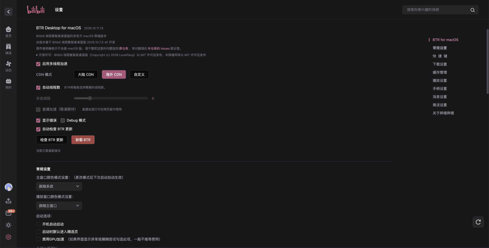

<div align="center">


# BTR Desktop for macOS（非官方）

**[Bilibili 线程撕裂者桌面版](https://github.com/MrTangLuyao/Bilibili-thread-ripper-desktop) 的 macOS 移植，适用于官方哔哩哔哩 macOS 客户端**

把线程撕裂者带到官方 macOS 客户端里，原本的播放器、字幕、弹幕和快捷键都保留

已在 macOS 27.2（Apple M4）、官方客户端 **1.19.0**、BTR Desktop **2026.10.19.1-d1** 实测

[](#-安装) [](https://github.com/MrTangLuyao/Bilibili-thread-ripper-desktop) [](https://github.com/MrTangLuyao/Bilibili-thread-ripper) [](LICENSE)

[**安装**](#-安装) · [设置](#️-设置) · [直播加速](#-直播加速实验性) · [更新](#-更新) · [卸载](#-卸载) · [常见问题](#-常见问题) · [原项目](https://github.com/MrTangLuyao/Bilibili-thread-ripper-desktop)

 

</div>

> [!WARNING]
> 这是社区做的**非官方**移植，不是原作者发布的版本。原作者明确表示不会做 macOS 版，**请不要把这里的问题报到原仓库**，有问题请在本仓库的 Issues 里反馈。
>
> 作者能力有限，可能不会长期维护此项目。

> [!NOTE]
> 和原版一样，桌面版工作在类似网页版“兼容模式”的方式下：只接管视频下载，播放仍由客户端自己负责，所以效果可能不如网页版，但相比原生依旧提升明显。

## ✨ 它能做什么

- **原生客户端不变**：播放器、字幕、弹幕和快捷键都保留，BTR 只接管视频下载
- **直播加速（实验性）**：移植自网页版的直播模块，直播分片从多个节点竞速下载，并提前预取下一片，减少卡顿和转圈。默认关闭，在设置里打开
- **内置原项目代码**：[desktop/](desktop) 里是 BTR Desktop 2026.10.19.1-d1 的源码（MIT），直播模块来自网页版；本仓库只加了把它们装进 macOS 客户端的注入代码（[payload/](payload)）和直播间里的开关
- **客户端里更新和卸载**：设置页里检查更新、一键卸载，确认后在“终端”里完成，结束后自动重新打开客户端
- **随时一键还原**：安装前完整备份官方客户端，卸载时原样还原，不动账号和数据
- **只用系统自带工具**：`python3`、`git` 和 `codesign`，不需要安装 Node.js

## 📦 安装

**准备**

- 官方哔哩哔哩 macOS 客户端，放在“应用程序”文件夹里（`/Applications` 或 `~/Applications`）
- 命令行开发者工具（提供 `git` 和 `python3`）。没装过的话，第一次运行 `git` 时系统会弹窗提示安装，也可以先运行 `xcode-select --install`
- 给“终端”打开 **系统设置 → 隐私与安全性 → App 管理** 权限，然后重开终端。安装、更新、卸载都要修改客户端，客户端里的更新和卸载按钮也是交给系统自带的“终端”来完成的

**安装**

1. **完全退出客户端**（⌘Q）
2. 在“终端”里运行下面两行（第一次安装和以后手动更新都用它们）：

   ```bash
   [ -d ~/btr-mac ] || git clone https://github.com/luitao666-arch/Bilibili-thread-ripper-mac.git ~/btr-mac
   bash ~/btr-mac/install-mac.sh
   ```

3. **从程序坞或启动台**打开客户端，在 **设置 → BTR Desktop for macOS** 里调整

脚本每次都会先拉取本仓库的最新代码再安装，内容可以直接查看 [install-mac.sh](install-mac.sh)。第一次安装会把官方客户端备份到 `~/Library/Application Support/BTR-Mac/backup/`（约 400 MB），卸载时用它还原。

> [!TIP]
> 客户端没装在“应用程序”文件夹也没关系：脚本会用 Spotlight 找；还找不到的话，用 `BTR_APP=/path/to/哔哩哔哩.app bash ~/btr-mac/install-mac.sh` 指定。

> [!IMPORTANT]
> 装着 BTR 的时候请保留 `~/btr-mac`：客户端里的更新和卸载按钮会用到里面的脚本。

## ⚙️ 设置

设置项和原版相同，只多了一个“直播加速（实验性）”。设置页标题下面会显示 macOS 移植的版本、基于的 BTR Desktop 版本、问题反馈说明和原项目的 MIT 许可证。有两个入口，两边的设置同步：

| 入口 | 可以调整 |
| --- | --- |
| **设置** 最上面的“BTR Desktop for macOS”（右侧目录里叫“BTR for macOS”，页首左图） | 全部设置，以及检查更新、卸载 |
| 播放器 **齿轮 → 更多播放设置**（页首右图） | CDN 和线程数 |
| 直播间画面右下角的 **清晰度菜单** | 直播加速的开关，以及当前的加速状态 |

| 设置 | 默认 | 说明 |
| --- | --- | --- |
| 启用多线程加速 | 开 | 关掉后完全交给客户端自己下载 |
| CDN 模式 | 大陆 CDN | 也可以选海外或自定义（勾选节点，或手动添加 B 站的视频服务器） |
| 自动线程数 | 开 | BTR 自动选择需要的线程数 |
| 并发线程 | 8 | 关掉“自动线程数”后才生效，一般推荐 8 到 32，不够流畅再往上加 |
| 显示错误 | 关 | 红色错误提示默认不显示，需要排查时打开 |
| Debug 模式 | 关 | 显示 BTR 的工作过程，用来确认 BTR 在工作 |
| 自动检查 BTR 更新 | 开 | 每 30 分钟检查一次，有新版本时在这个设置页里显示，不会弹窗 |
| 直播加速（实验性） | 关 | 打开后，直播间的清晰度菜单里会多一个开关，可以随时关掉。关着时不会往直播间注入任何代码，详见[直播加速](#-直播加速实验性) |

自定义 CDN、坏节点自动停用等功能的说明请看 [原项目的设置说明](https://github.com/MrTangLuyao/Bilibili-thread-ripper-desktop#️-设置)。

想确认 BTR 在工作：在 **设置 → BTR Desktop for macOS** 打开 Debug，播放视频时会出现“已收到客户端播放地址”等提示。

## 📡 直播加速（实验性）

还在实验阶段，默认关闭。直播代码移植自[网页版](https://github.com/MrTangLuyao/Bilibili-thread-ripper)：直播分片同时从多个直播节点竞速下载，某个节点变慢就换，并提前把下一片下好。

1. 在 **设置 → BTR Desktop for macOS** 打开 **直播加速（实验性）**
2. 打开任意直播间，把鼠标移到画面右下角的清晰度（例如“1080P 原画”）上，菜单最上面一行就是 **BTR 直播加速** 开关，默认开着

**怎么看有没有在加速**

- 清晰度文字前面有粉色的 **BTR** 标签：正在加速；灰色：开着但最近没有接管分片；关掉后标签不显示
- 清晰度菜单里开关下面会显示实时状态，例如“加速中 · 已接管 183 个分片 · 0.69 MB/s · 5/5 个节点可用”

直播是主播推一点、你才能下一点，所以显示的速度基本等于这个直播的码率，不会像点播那样很高。直播加速的作用是减少卡顿和转圈，不是让速度数字变大。

在直播间里关掉开关，会记住到下次；在设置里关掉“直播加速（实验性）”，已经开着的直播间也会马上停止。只支持 fMP4 格式的直播流，其他格式自动交给客户端原来的方式播放。

## 🔄 更新

在 **设置 → BTR Desktop for macOS** 点 **检查 BTR 更新**（打开“自动检查 BTR 更新”时，有新版本也会直接显示在这里）。它同时检查原仓库的 BTR 新版本和本仓库的 macOS 移植新版本，有更新时点 **更新到 …** 并确认：会先打开“终端”，然后客户端自动关闭，终端里完成更新后重新打开客户端；失败时终端窗口停留并显示错误。

也可以 ⌘Q 退出客户端后在终端更新：

```bash
bash ~/btr-mac/install-mac.sh update
```

更新会保留客户端的设置和热更新状态，不会清空账号和官方客户端数据。

### 官方客户端更新以后

官方客户端平时的热更新不会去掉 BTR。如果重新下载官方安装包覆盖安装，BTR 会被覆盖，⌘Q 退出客户端后再运行一次安装命令即可（macOS 版没有原版那样的后台监视提醒）。

## 🧹 卸载

在 **设置 → BTR Desktop for macOS** 点红色的 **卸载 BTR** 并确认，或者 ⌘Q 退出客户端后在终端运行：

```bash
bash ~/btr-mac/install-mac.sh uninstall
```

卸载会用安装前的完整备份恢复官方客户端（包括苹果原签名），不删除账号、缓存和个人设置，然后清理 BTR 留下的东西：

- `~/Library/Application Support/BTR-Mac` 里的备份、BTR 源码和日志
- 客户端缓存（`~/Library/Application Support/bilibili/resource`）里带 BTR 的客户端副本，换回官方版本

卸载只删除 BTR 自己创建的文件：删除前会确认客户端确实是哔哩哔哩、数据目录确实是 BTR 的，不会动到别的应用和你自己的文件。安装脚本所在的 `~/btr-mac` 不会自动删除，不再需要的话自己删除即可：

```bash
rm -rf ~/btr-mac
```

## ❓ 常见问题

**设置里找不到“BTR Desktop for macOS”**

1. 先看 BTR 有没有装上：在终端运行 `bash ~/btr-mac/install-mac.sh status`，输出里的 `installed` 是 `null` 就说明没装上，重新安装一次。
2. 装上了还是找不到的话，一般是客户端自己还没更新界面。官方客户端刚安装时用的是旧界面，打开后会自动下载新界面，BTR 的设置项要在新界面里才有。到客户端的 **设置 → 关于哔哩哔哩** 点 **检查更新**（或者多开关几次客户端），出现“重启升级”时点它，重启后就能看到了。

**更新后设置变回了默认，或者点了“重启升级”后客户端卡住不动**

2026.10.11.8 之前的版本会这样。卡住的话先按 ⌥⌘Esc 强制退出，再从程序坞打开客户端；然后按 ⌘Q 退出，在终端运行 `bash ~/btr-mac/install-mac.sh update` 更新到最新版。更新之后就不会再出现了。

**在客户端里点了更新，客户端关掉后没有再打开**

2026.10.11.4 之前的版本会这样，按上一条在终端里更新一次就好。新版本更新时会弹出“终端”窗口显示进度；如果更新失败，窗口不会关，可以在里面看到出错信息，完整日志在 `~/Library/Application Support/BTR-Mac/maintain.log`。

**直播间的清晰度菜单里没有 BTR 开关**

先确认 **设置 → BTR Desktop for macOS** 里打开了“直播加速（实验性）”。打开之后，已经开着的直播间会马上出现开关，不需要重开。

**开了直播加速，速度只有零点几 MB/s**

这是正常的，见上面的[直播加速](#-直播加速实验性)：直播的速度由主播推流的码率决定，看标签是不是粉色、分片数有没有在增加，就能确认在加速。

**提示没有权限修改客户端**

打开 **系统设置 → 隐私与安全性 → App 管理**，允许“终端”（以及你正在用的其他终端），然后重开终端再运行。

## ⚠️ 注意事项

- 本地签名后，macOS 不再认为这是哔哩哔哩官方签名的应用。备份里保留了原版，随时可以还原。
- 官方客户端会根据 `Resources/app-update.yml` 判断自己是否被重新安装，判断为重装就会恢复默认设置并重新下载热更新。安装、更新和卸载时脚本会同步这条记录（`~/Library/Application Support/bilibili/resource/.appInfo`），避免设置被重置。
- 欢迎在 Issues 里补充其他 macOS / 客户端版本的测试结果（`bash ~/btr-mac/install-mac.sh status` 可以看到客户端和 BTR 的版本）。

## 📄 致谢与许可

- BTR 下载内核与界面：[MrTangLuyao/Bilibili-thread-ripper-desktop](https://github.com/MrTangLuyao/Bilibili-thread-ripper-desktop)，作者 LouieTang，MIT 许可证；图标同样来自原项目
- 直播加速模块：[MrTangLuyao/Bilibili-thread-ripper](https://github.com/MrTangLuyao/Bilibili-thread-ripper)（网页版），版权归 Bilibili-thread-ripper contributors，MIT 许可证，全文见 [desktop/LICENSE-Bilibili-thread-ripper](desktop/LICENSE-Bilibili-thread-ripper)
- `btr_mac.py` 的 ASAR 读写和注入方式移植自原仓库的 `tools/asar.cjs` 与 `tools/client-package.cjs`

本仓库同样以 [MIT 开源协议](LICENSE) 发布。
